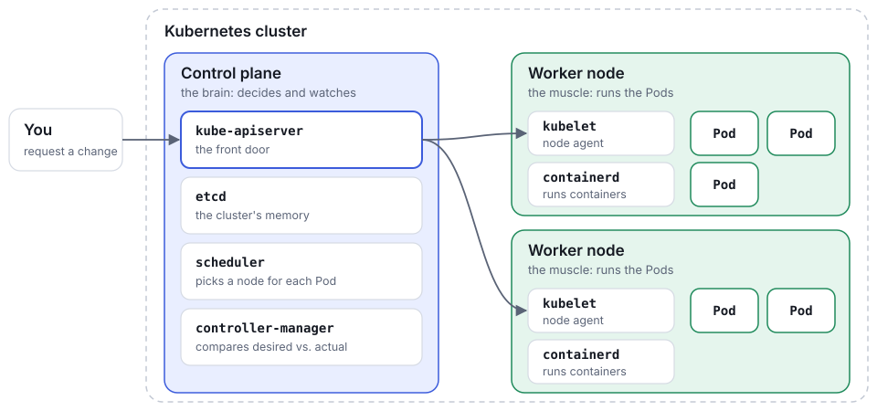
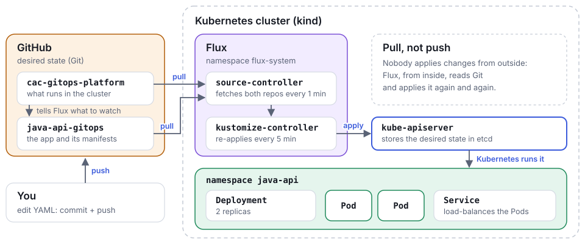

# Training 01 — GitOps and Flux foundations

<!--
Content of this training's website. Conventions (see site/README.md):
- Each "## Title {label}" is a section (one screen in presentation mode).
- "> [!NOTE]", "> [!TIP]", "> [!WARNING]" are callouts.
- "> [!DOCS]" with a list of links: further reading, at the foot of the section.
- ```flow, ```cards, ```steps and ```row blocks: one item per line, "Title | text".
- ```compare block: two lines, "Title | point | point…"; the first is what is in, the second what is left out.
- "repo:path" links point to the file on GitHub, on the published branch.
-->

## What this talk is (and isn't) about {Scope}

How software gets to run, **not the software itself**.

```compare
Today | Kubernetes | Configuration as code (CaC) | CD with GitOps and Flux | The Linux terminal | Git and GitHub
Not today | Docker | Infrastructure as code (IaC) | CI | Programming languages | User interfaces or hardware
```

## Introduction {Context}

- **Where:** IOPEDGE architecture, for Inditex
- **What we provide:** a *locations* system where other teams deploy their workloads


## What is a Kubernetes cluster? {Theory}

A **cluster** is a group of machines, called **nodes**, that work as if they were one.\
[Kubernetes](https://kubernetes.io/docs/concepts/overview/) coordinates them: you say *what* to run; it decides *where* and keeps it running.



> [!DOCS]
> - [Kubernetes: cluster components](https://kubernetes.io/docs/concepts/overview/components/)
> - [Kubernetes: Pods](https://kubernetes.io/docs/concepts/workloads/pods/)
> - [Kind cluster tour](repo:docs/en/reference/kind-cluster-tour.md)
> - [Kind](https://kind.sigs.k8s.io/)

## Kubernetes doesn't run commands: it reconciles state {Theory}

The basis of GitOps: **the same pattern**, with Git as the input.

```flow
YAML / spec | You declare what you want, not how.
`kube-apiserver` | Validates it and stores it in `etcd` as desired state.
`controller-manager` | Its controllers compare desired and actual, and act.
Status | Reports the observed real state.
```

The controller repeats this loop forever and acts when they differ.

> [!DOCS]
> - [Kubernetes concepts](repo:docs/en/reference/kubernetes-concepts.md)
> - [Kubernetes: controllers](https://kubernetes.io/docs/concepts/architecture/controller/)
> - [Kubernetes: objects](https://kubernetes.io/docs/concepts/overview/working-with-objects/)

## Anatomy of a manifest {Theory}

Every object tells the same story: who I am, what I want, what is happening.

```yaml
apiVersion: apps/v1
kind: Deployment
metadata:
  name: my-app
  labels:
    app.kubernetes.io/name: my-app
spec:
  replicas: 2            # what Git edits
status:
  availableReplicas: 2   # what the cluster reports
```

```cards
apiVersion + kind | The kind of contract with Kubernetes.
metadata | Name, labels, namespace.
spec | State **desired** by the team — what Git edits.
status | State **observed** by the cluster — what `kubectl` reports.
```

> [!DOCS]
> - [Kubernetes: `spec` and `status`](https://kubernetes.io/docs/concepts/overview/working-with-objects/#object-spec-and-status)
> - [Labels and selectors](https://kubernetes.io/docs/concepts/overview/working-with-objects/labels/)
> - [Kubernetes concepts](repo:docs/en/reference/kubernetes-concepts.md)

## GitOps: Git as the operating contract {Theory}

Git stops being just history and becomes the input the cluster obeys.

![The five layers, top to bottom: 1, the code (pom.xml, src/, Dockerfile and k8s/ in java-api-gitops); 2, docker build creates an OCI image in two stages, a Maven build stage and a JRE 21 runtime stage; 3, docker push publishes it to a registry such as Docker Hub, GHCR or Amazon ECR; 4, the YAML in Git pins the tag and Flux, with source-controller and kustomize-controller, applies it to kube-apiserver; 5, Kubernetes creates the Deployment, its ReplicaSet and two Pods, and the kubelet pulls the image from the registry](diagrams/gitops-pipeline.en.svg)

The four [OpenGitOps](https://opengitops.dev/) principles:

```row
Declarative | Desired state, not steps.
Versioned and immutable | Lives in Git, with history.
Pulled automatically | An agent in the cluster pulls it.
Continuously reconciled | Corrects drift every interval.
```

> [!DOCS]
> - [OpenGitOps principles](https://opengitops.dev/)
> - [Flux: core concepts](https://fluxcd.io/flux/concepts/)

## How it all fits together: Git, Flux and Kubernetes {Our scenario}

[Flux](https://fluxcd.io/flux/) is a set of controllers that live **inside** the cluster. They watch your Git repositories and apply what they find to Kubernetes, again and again. You only change Git, split across two repositories with separate responsibilities so that every change is **repeatable and auditable**.



```row
cac-gitops-platform | What runs in the cluster: Flux bootstrap, the `java-api` namespace and which applications it watches.
java-api-gitops | The application: Spring Boot code, `Dockerfile` and its manifests (Deployment, Service and ConfigMap).
```

> [!DOCS]
> - [`GitRepository`](https://fluxcd.io/flux/components/source/gitrepositories/)
> - [`Kustomization`](https://fluxcd.io/flux/components/kustomize/kustomizations/)
> - [Flux architecture](repo:docs/en/reference/flux-architecture.md)
> - [`cac-gitops-platform`, file by file](repo:references/en/cac-gitops-platform.md)
> - [`java-api-gitops`, file by file](repo:references/en/java-api-gitops.md)

## Demo 1 — A commit becomes cluster state {Live demo}

```steps
Edit | In `k8s/deployment.yaml`, change `replicas: 2` → `1`.
Commit + push | To the `training/01-gitops-flux-foundations` branch.
Reconcile | Ask Flux to re-read Git and apply now, without waiting for the interval.
Verify | The Deployment goes to `1/1`.
```

```bash
git add k8s/deployment.yaml
git commit -m "scale java-api to 1 replica"
git push

flux reconcile kustomization java-api -n flux-system --with-source
kubectl rollout status deployment/api-java-gitops -n java-api
```

> [!DOCS]
> - [`flux reconcile`](https://fluxcd.io/flux/cmd/flux_reconcile/)
> - [`kubectl rollout`](https://kubernetes.io/docs/reference/kubectl/generated/kubectl_rollout/)
> - [Learner guide](repo:training/01-gitops-flux-foundations/learner-guide.md)

## Demo 2 — Cause drift and watch it self-correct {Live demo}

A manual change in the cluster **is not** desired state.

```bash
kubectl scale deployment/api-java-gitops -n java-api --replicas=3
kubectl get deployment/api-java-gitops -n java-api   # 3/3, briefly

flux reconcile kustomization java-api -n flux-system --with-source
kubectl get deployment/api-java-gitops -n java-api   # back to 1/1
```

Kubernetes obeys the `scale` instantly because it doesn't know Git says `1`. On the next reconciliation, Flux compares Git with the cluster and undoes the manual change.

> [!TIP]
> It isn't magic: it is `kubectl apply` re-applied to an object that drifted from its YAML.

> [!DOCS]
> - [Why drift correction works](repo:docs/en/reference/flux-architecture.md#why-drift-correction-works)
> - [`kubectl scale`](https://kubernetes.io/docs/reference/kubectl/generated/kubectl_scale/)

## Rollback through Git, and what to avoid {Wrap-up}

```bash
git revert HEAD --no-edit
git push
flux reconcile kustomization java-api -n flux-system --with-source
```

Flux reconciles the reverted state like any other commit, and the history of what happened stays intact.

> [!WARNING]
> Avoid `kubectl rollout undo`: it changes the cluster without changing Git, and Flux undoes it on the next cycle. Also avoid a manual `kubectl apply` against `java-api`: Flux already manages it, and doing it by hand blurs the source of truth.

> [!DOCS]
> - [`git revert`](https://git-scm.com/docs/git-revert)
> - [Flux: `prune`](https://fluxcd.io/flux/components/kustomize/kustomizations/#prune)

## Practise on your own {Learners}

Repeat the whole exercise on **your own forks** with the [learner guide](repo:training/01-gitops-flux-foundations/learner-guide.md): forking the repositories, initial setup, Flux bootstrap, exercises and rollback.

```cards
Fork | [`cac-gitops-platform`](https://github.com/toniferr/cac-gitops-platform) and [`java-api-gitops`](https://github.com/toniferr/java-api-gitops) into your account, unticking "Copy the `main` branch only".
Branch | `training/01-gitops-flux-foundations` in both forks.
Environment | [WSL2/Ubuntu setup](repo:docs/en/01-wsl-ubuntu-setup.md) and a `kind` cluster.
```

> [!DOCS]
> - [Kind: quick start](https://kind.sigs.k8s.io/docs/user/quick-start/)
> - [Post-bootstrap tour](repo:docs/en/reference/post-bootstrap-tour.md)
> - [Troubleshooting recipe](repo:docs/en/reference/kubectl-cheatsheet.md#troubleshooting-recipe)
