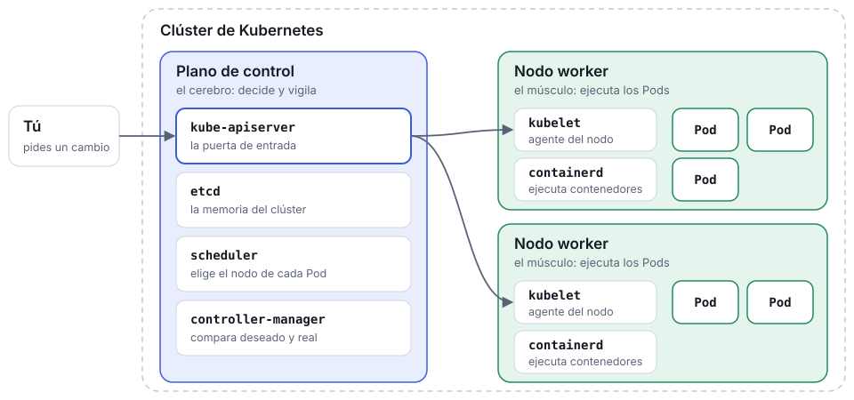

# Formación 01 — Fundamentos de GitOps y Flux

<!--
Contenido de la web de esta formación. Convenciones (ver site/README.md):
- Cada "## Título {etiqueta}" es una sección (una pantalla en modo presentación).
- "> [!NOTE]", "> [!TIP]", "> [!WARNING]" son avisos.
- "> [!DOCS]" con una lista de enlaces: documentación para ampliar, al pie de la sección.
- Bloques ```flow, ```cards, ```steps y ```row: una línea por elemento, "Título | texto".
- Bloque ```compare: dos líneas, "Título | punto | punto…"; la primera es lo que entra, la segunda lo que queda fuera.
- Enlaces "repo:ruta" apuntan al fichero en GitHub, en la rama publicada.
-->

## De qué va esta charla (y de qué no) {Alcance}

Cómo llega el software a ejecutarse, **no el software en sí**.

```compare
Sí veremos | Kubernetes | Configuración como código (CaC) | CD con GitOps y Flux | Arquitectura de plataforma
No veremos | Docker | Infraestructura como código (IaC) | CI | IA ni lenguajes de programación | Interfaces de usuario ni hardware
```

## Introducción {Contexto}

- **Dónde:** arquitectura de IOPEDGE, para Inditex
- **Qué proveemos:** un sistema de *locations* donde otros equipos despliegan sus workloads


## ¿Qué es un clúster de Kubernetes? {Teoría}

Un **clúster** es un grupo de máquinas, llamadas **nodos**, que trabajan como si fueran una sola.\
[Kubernetes](https://kubernetes.io/docs/concepts/overview/) las coordina: tú dices *qué* ejecutar; él decide *dónde* y lo mantiene en marcha.



> [!DOCS]
> - [Kubernetes: componentes del clúster](https://kubernetes.io/docs/concepts/overview/components/)
> - [Kubernetes: Pods](https://kubernetes.io/docs/concepts/workloads/pods/)
> - [Recorrido por el clúster Kind](repo:docs/es/reference/recorrido-cluster-kind.md)
> - [Kind](https://kind.sigs.k8s.io/)

## Kubernetes no ejecuta órdenes: reconcilia estado {Teoría}

La base de GitOps: **el mismo patrón**, con Git como entrada.

```flow
YAML / spec | Declaras qué quieres, no cómo hacerlo.
`kube-apiserver` | Lo valida y lo guarda en `etcd` como estado deseado.
`controller-manager` | Sus controladores comparan deseado y real, y crean o borran Pods; el `scheduler` elige su nodo.
Status | Reporta el estado real observado.
```

El controlador repite este ciclo sin fin y actúa si difieren.

> [!DOCS]
> - [Conceptos de Kubernetes](repo:docs/es/reference/conceptos-kubernetes.md)
> - [Kubernetes: controladores](https://kubernetes.io/docs/concepts/architecture/controller/)
> - [Kubernetes: objetos](https://kubernetes.io/docs/concepts/overview/working-with-objects/)

## Anatomía de un manifiesto {Teoría}

Todo objeto cuenta la misma historia: quién soy, qué quiero, qué está ocurriendo.

```yaml
apiVersion: apps/v1
kind: Deployment
metadata:
  name: mi-app
  labels:
    app.kubernetes.io/name: mi-app
spec:
  replicas: 2            # lo que edita Git
status:
  availableReplicas: 2   # lo que reporta el clúster
```

```cards
apiVersion + kind | Tipo de contrato con Kubernetes.
metadata | Nombre, labels, namespace.
spec | Estado **deseado** por el equipo — lo que edita Git.
status | Estado **observado** por el clúster — lo que reporta `kubectl`.
```

> [!DOCS]
> - [Kubernetes: `spec` y `status`](https://kubernetes.io/docs/concepts/overview/working-with-objects/#object-spec-and-status)
> - [Labels y selectores](https://kubernetes.io/docs/concepts/overview/working-with-objects/labels/)
> - [Conceptos de Kubernetes](repo:docs/es/reference/conceptos-kubernetes.md)

## GitOps: Git como contrato operativo {Teoría}

Git pasa a ser la entrada que el clúster obedece, según [OpenGitOps](https://opengitops.dev/).


```row
Declarativo | Estado deseado, no pasos.
Versionado e inmutable | Vive en Git, con historial.
Pull automático | Un agente en el clúster lo trae.
Reconciliación continua | Corrige el drift en cada intervalo.
```

> [!DOCS]
> - [Principios de OpenGitOps](https://opengitops.dev/)
> - [Flux: conceptos básicos](https://fluxcd.io/flux/concepts/)

## Cómo encaja todo: Git, Flux y Kubernetes {Nuestro escenario}

[Flux](https://fluxcd.io/flux/) vive **dentro** del clúster: vigila Git y aplica lo que encuentra, una y otra vez. Tú solo cambias Git, en dos repos separados, para que cada cambio sea **repetible y auditable**.


```row
cac-gitops-platform | Qué corre en el clúster: Flux, namespaces y apps vigiladas.
java-api-gitops | La app: código, `Dockerfile` y manifiestos.
```

> [!DOCS]
> - [`GitRepository`](https://fluxcd.io/flux/components/source/gitrepositories/)
> - [`Kustomization`](https://fluxcd.io/flux/components/kustomize/kustomizations/)
> - [Arquitectura de Flux](repo:docs/es/reference/arquitectura-flux.md)
> - [`cac-gitops-platform`, fichero a fichero](repo:references/es/cac-gitops-platform.md)
> - [`java-api-gitops`, fichero a fichero](repo:references/es/java-api-gitops.md)

## Demo 1 — Un commit se convierte en estado del clúster {Demo en vivo}

```steps
Editar | En `k8s/deployment.yaml`, cambia `replicas: 2` → `1`.
Commit + push | A la rama `training/01-gitops-flux-foundations`.
Reconciliar | Pide a Flux que relea Git y aplique ya, sin esperar al intervalo.
Verificar | El Deployment pasa a `1/1`.
```

```bash
git add k8s/deployment.yaml
git commit -m "scale java-api to 1 replica"
git push

flux reconcile kustomization java-api -n flux-system --with-source
kubectl rollout status deployment/api-java-gitops -n java-api
```

> [!DOCS]
> - [`flux reconcile`](https://fluxcd.io/flux/cmd/flux_reconcile/)
> - [`kubectl rollout`](https://kubernetes.io/docs/reference/kubectl/generated/kubectl_rollout/)
> - [Guía del alumno](repo:training/01-gitops-flux-foundations/learner-guide.es.md)

## Demo 2 — Provocar drift y verlo corregirse {Demo en vivo}

Un cambio manual en el clúster **no es** estado deseado.

```bash
kubectl scale deployment/api-java-gitops -n java-api --replicas=3
kubectl get deployment/api-java-gitops -n java-api   # 3/3, momentáneamente

flux reconcile kustomization java-api -n flux-system --with-source
kubectl get deployment/api-java-gitops -n java-api   # vuelve a 1/1
```

Kubernetes obedece el `scale` al instante porque no sabe que Git dice `1`. En la siguiente reconciliación, Flux compara Git con el clúster y deshace el cambio manual.

> [!TIP]
> No es magia: es `kubectl apply` reaplicado sobre un objeto que se desvió de su YAML.

> [!DOCS]
> - [Por qué funciona la corrección de drift](repo:docs/es/reference/arquitectura-flux.md#por-qué-funciona-la-corrección-de-drift)
> - [`kubectl scale`](https://kubernetes.io/docs/reference/kubectl/generated/kubectl_scale/)

## Rollback por Git, y qué evitar {Cierre}

```bash
git revert HEAD --no-edit
git push
flux reconcile kustomization java-api -n flux-system --with-source
```

Flux reconcilia el estado revertido igual que cualquier otro commit, y el historial de lo ocurrido queda intacto.

> [!WARNING]
> Evita `kubectl rollout undo`: cambia el clúster sin cambiar Git, y Flux lo deshace en el siguiente ciclo. Evita también `kubectl apply` manual contra `java-api`: Flux ya lo gestiona y hacerlo a mano confunde el origen de verdad.

> [!DOCS]
> - [`git revert`](https://git-scm.com/docs/git-revert)
> - [Flux: `prune`](https://fluxcd.io/flux/components/kustomize/kustomizations/#prune)

## Practica por tu cuenta {Si te pica el gusanillo}

Repite el ejercicio completo en **tus propios forks**, con la [guía del alumno](repo:training/01-gitops-flux-foundations/learner-guide.es.md): fork de los repositorios, configuración inicial, bootstrap de Flux, ejercicios y rollback.

```cards
Fork | [`cac-gitops-platform`](https://github.com/toniferr/cac-gitops-platform) y [`java-api-gitops`](https://github.com/toniferr/java-api-gitops) en tu cuenta, desmarcando «Copy the `main` branch only».
Rama | `training/01-gitops-flux-foundations` en ambos forks.
Entorno | [Preparación de WSL2/Ubuntu](repo:docs/es/01-preparacion-wsl-ubuntu.md) y clúster `kind`.
```

> [!DOCS]
> - [Kind: quick start](https://kind.sigs.k8s.io/docs/user/quick-start/)
> - [Recorrido post-bootstrap](repo:docs/es/reference/recorrido-post-bootstrap.md)
> - [Receta de troubleshooting](repo:docs/es/reference/chuleta-kubectl.md#receta-de-troubleshooting)
